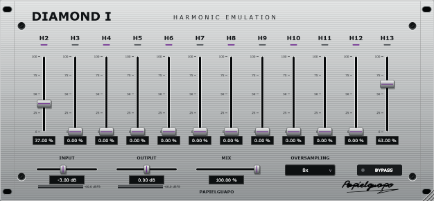

# DIAMOND I — PAPIELGUAPO

By **PAPIELGUAPO**. Plugin JUCE independiente para Windows x64, VST3 y Standalone. Doce faders H2–H13, INPUT/OUTPUT ±24 dB, MIX 0–100%, oversampling FIR 2x/4x/8x, bypass con transición y medidores estéreo. Arranca limpio, con los doce armónicos a cero. Doble clic restablece cada fader. El host guarda y automatiza los 17 parámetros. La interfaz se abre siempre al 50% (626 × 290 px); arrastra la esquina o haz clic derecho en el fondo para elegir un tamaño entre el 25% y el 200%. Al cerrar y volver a abrir comienza otra vez en pequeño, también al cargar un preset antiguo.

## Referencias inspeccionadas

Los originales se han leído, sin modificarlos:

* Diamond II: proyecto original `diamond-ii-vst3`. Revisados Processor/Editor `.cpp/.h`, DiamondLook, assets y CMake. Se adaptan su construcción de metal cepillado, colores, tornillería, tipografía del sistema y extracción de firma desde `rack-reference.png`. El panel se amplía a 1252×580 para alojar faders. Los faders son nuevos y usan el mismo acabado metálico y acento violeta.
* D2F: proyecto original `D2F`. Revisados Processor/Editor `.cpp/.h`, parámetros, estado y CMake. No se confunde con la variante D2F-SCOPE localizada también en disco. La etapa Color de D2F evalúa `y = (x + 2*Even*x*x + 2*Odd*x*x*x)/(1 + 1.2*(Even+Odd))`, con controles 0–100 divididos entre 100 y oversampling FIR 4x. El término cúbico modifica también el fundamental; el cuadrático añade continua; el denominador acopla ambos controles. La etapa Inflate y los filtros Air/Sub son procesos adicionales, no generadores independientes H2–H13. No se han copiado al nuevo motor.

Se utiliza por ello la alternativa Chebyshev autorizada, en lugar de presentar el motor nuevo como una copia sonora exacta de D2F. La licencia original de Diamond II se conserva en `docs/DiamondII-LICENSE`. JUCE se suministra externamente y conserva sus propios términos de licencia.

## Motor y calibración

`T0=1`, `T1=x`, `Tn=2*x*T(n-1)-T(n-2)`. Cada contribución es `(fader/100)^2/n * (Tn(x)-Tn(0))`. No hay normalización compartida ni controles que cambien los coeficientes de otros generadores. H2 a 100% entrega un segundo armónico de amplitud 0,5; H13 entrega 1/13. El taper cuadrático ofrece ajuste fino cerca de cero. No se atenúa automáticamente la salida: combinar armónicos y ganancias puede superar 0 dBFS, por lo que debe ajustarse OUTPUT.

**La separación espectral se calibra con una senoide de amplitud pico 1 (0 dBFS) a la entrada del generador.** Con amplitudes diferentes, Chebyshev produce también componentes de órdenes inferiores de la misma paridad. INPUT afecta esa excitación. Con material complejo aparece intermodulación. No se promete aislamiento espectral universal, ni emulación analógica exacta ni correspondencia sonora total con D2F.

Se resta Tn(0) para que el silencio no excite armónicos pares; un servo de continua a 3 Hz elimina el desplazamiento medio restante. Para niveles superiores a ±1 se prolonga cada polinomio linealmente usando su pendiente en el extremo; esto evita crecimiento exponencial sin recortar la señal ni insertar un limitador de salida. Fuera de ese intervalo la calibración senoidal ya no se cumple.

Sólo la contribución armónica pasa por los filtros de oversampling. Se suma a la señal limpia retardada, lo que permite transparencia exacta con faders a cero y ganancias a 0 dB. MIX escala la contribución añadida; INPUT y OUTPUT siguen activos a MIX=0. Bypass devuelve la entrada original con la misma latencia y cruza en 25 ms. Una cola de continua puede persistir brevemente después de bajar todos los faders; `reset()` limpia los estados.

Las tres ramas FIR están preasignadas y funcionan continuamente. Se alinean a la mayor latencia entera, comunicada al host, y se cruzan durante 25 ms al cambiar de modo. Esto consume más CPU que mantener una sola rama, pero evita asignaciones, cambios de latencia y filtros sin historia al automatizar. Los parámetros continuos se suavizan durante 25 ms; los coeficientes armónicos se actualizan por muestra de la frecuencia base. Se procesan bloques mayores que el máximo anunciado por fragmentos sin redimensionar buffers. No hay archivos, bloqueos ni creación de filtros en `processBlock`. Se sanea entrada y salida no finitas y se desactivan denormales.

Cada etapa FIR usa un objetivo de diseño de rechazo de −120 dB, sin relajar las últimas etapas como hace la configuración estándar de JUCE. Esto reduce los errores de banda pasante que amplifican los órdenes altos. La latencia final es fija: **99 muestras**. Un objetivo de diseño del filtro no es una garantía de aliasing global: 2x sigue siendo insuficiente para un H13 generado por una senoide de 7 kHz. Para órdenes altos y material brillante se recomienda 8x; 4x también pasó las mediciones concretas incluidas. Ni 8x elimina universalmente el aliasing de toda entrada posible.

## Compilar

Requiere un checkout de JUCE (probado aquí con 9.0.4), CMake ≥3.22, MSVC y Windows SDK. No descarga dependencias ni instala archivos en los directorios originales.

```powershell
cmake -S . -B build-vs2022 -G "Visual Studio 17 2022" -A x64 -DDIAMOND_JUCE_PATH=C:/ruta/JUCE
cmake --build build-vs2022 --config Release --target DiamondI_VST3 DiamondVerify -- /m:1 /nr:false
ctest --test-dir build-vs2022 -C Release --output-on-failure
```

En esta máquina sólo se ha localizado Visual Studio 2026. La configuración para VS2022 está prevista mediante CMake, pero la ejecución con ese compilador debe comprobarse en un equipo que lo tenga instalado. Se usa `/m:1 /nr:false` porque la compilación paralela de MSBuild no progresó en este entorno.

## Verificar e instalar

`DiamondVerify` procesa el AudioProcessor real: 100 Hz, H2–H13 por separado, 44,1/48/96 kHz y los tres modos de oversampling. Exporta `docs/spectral.csv` con frecuencia FFT, amplitud del componente y mayor armónico residual H2–H20, y `docs/aliasing.csv` con el H13 plegado de tonos altos. Comprueba transparencia, estado, canal silencioso, entradas no finitas, bloques mayores que el anunciado, bypass y asignaciones C++ en audio. Exporta capturas a seis tamaños y comprueba apertura pequeña, reapertura, compatibilidad con estados antiguos y límites de escala. El contador de asignaciones cubre `new/new[]`, no constituye un perfilador de todas las llamadas del sistema.

El bundle VST3 se genera en `build/DiamondI_artefacts/Release/VST3/DIAMOND I - HARMONIC EMULATION.vst3`. Copiar **la carpeta .vst3 completa** a una carpeta VST3 que escanee FL Studio, por ejemplo `C:/Program Files/Common Files/VST3`, o añadir una carpeta de usuario desde el gestor de plugins. Después ejecutar Find installed plugins e insertar DIAMOND I en un slot del mezclador. El ZIP VST3 incluye `Install.ps1`: ejecutarlo solicita UAC y copia el bundle a la carpeta VST3 compartida. Esta entrega no modifica los archivos de FL Studio. Validación de carga y automatización dentro de FL Studio pendiente de prueba en el host.

No se han realizado pruebas en todas las versiones de Windows, todas las frecuencias o todos los hosts. Los CSV y el informe de ejecución describen la validación efectivamente realizada.

Los resultados de esta entrega están resumidos en [docs/RESULTADOS.md](docs/RESULTADOS.md). La carpeta `dist` contiene archivos ZIP separados del código fuente y del bundle VST3 completo.

## Descargas y auditoría

[VST3 Windows x64 y código fuente](https://github.com/papielguapo/DIAMOND-I-PAPIELGUAPO/releases/latest) · [Auditoría](AUDITORIA.md)



## Licencia

El código se publica bajo AGPL-3.0-or-later; véase LICENSE. Los fragmentos visuales derivados de Diamond II conservan su aviso MIT en docs/DiamondII-LICENSE. JUCE es una dependencia externa con sus propios términos.
